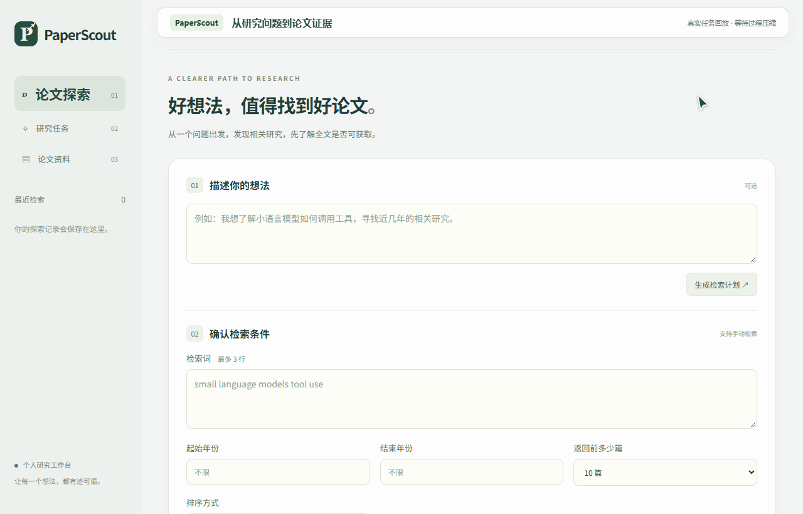
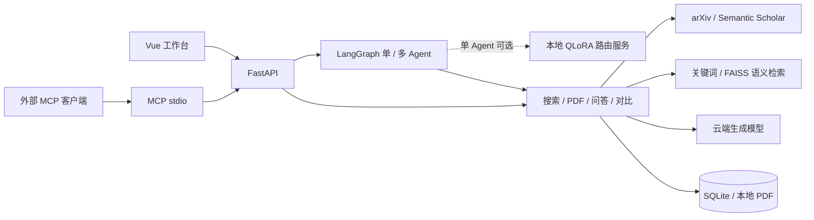
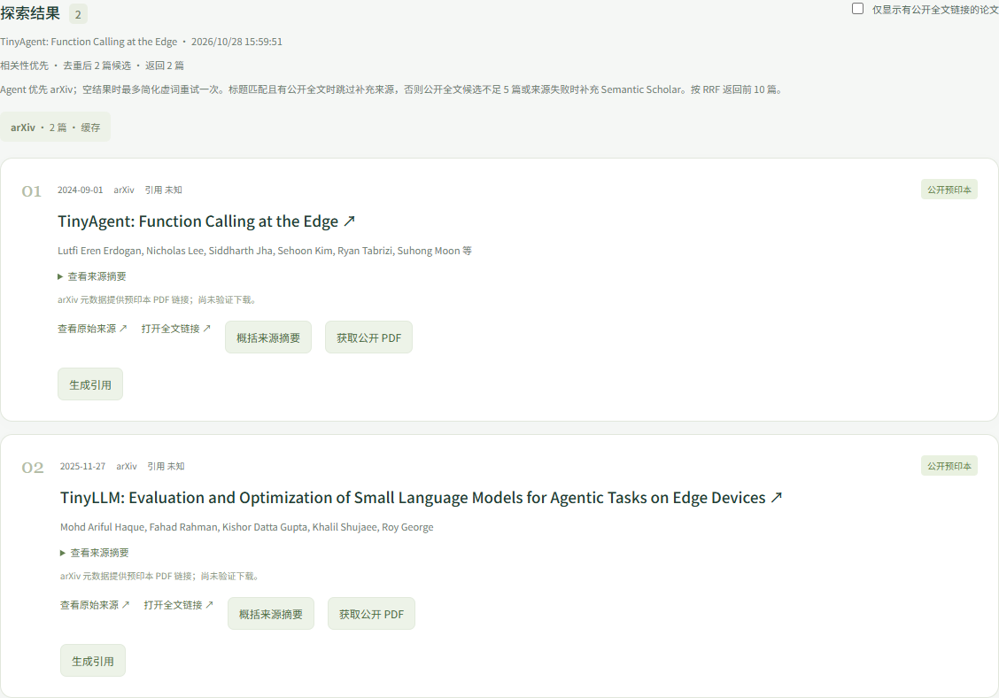
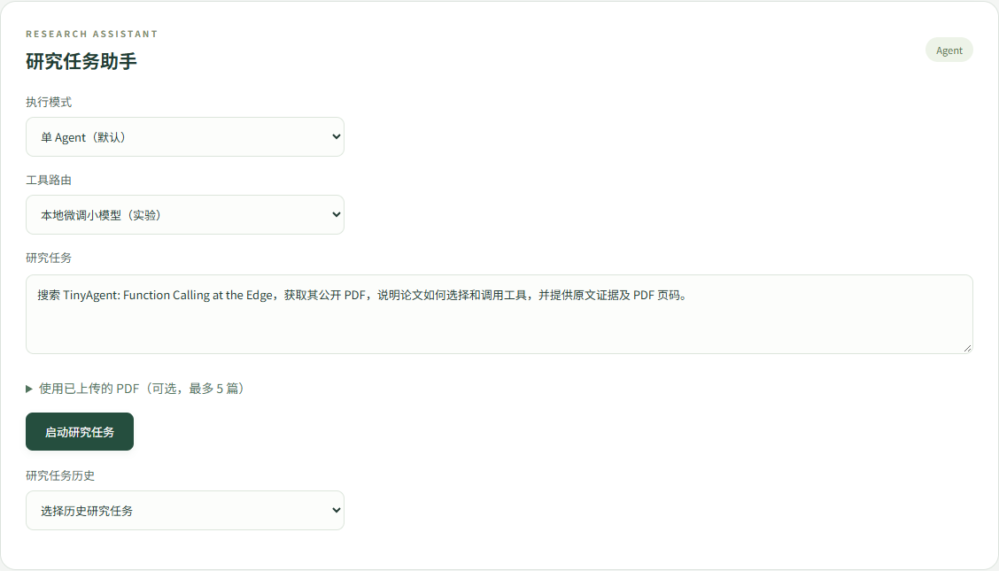
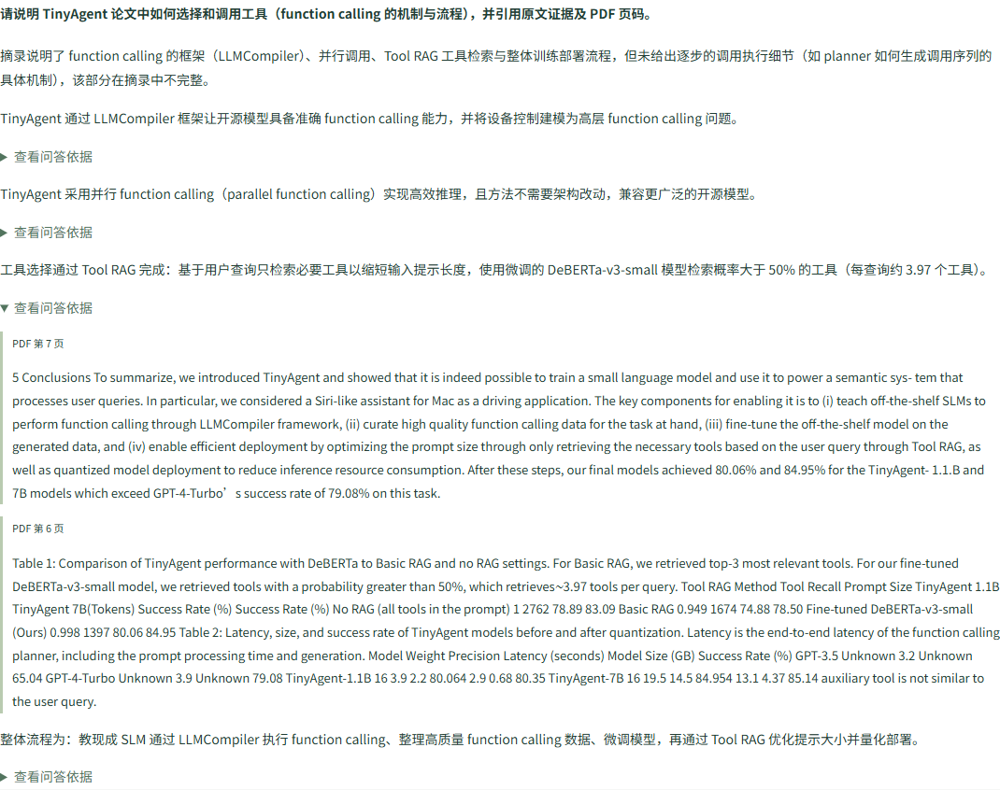

<div align="center">

<a id="paperscout"></a>

# 📚 PaperScout

**从研究想法出发，找到论文，读懂内容，追溯证据。**

论文检索 · RAG 问答 · 单 / 多 Agent · MCP · QLoRA 工具路由


[](LICENSE)

[应用 v1.0.0](https://github.com/mutesniper/PaperScout/releases/tag/paperscout-v1.0.0) · [路由适配器 v1.0.0](https://github.com/mutesniper/PaperScout/releases/tag/router-v1.0.0) · [路由候选 v1.1.0](https://github.com/mutesniper/PaperScout/releases/tag/router-v1.1.0-experimental.1)

[✨ 核心能力](#核心能力) · [🚀 快速开始](#快速开始) · [📚 使用示例](#使用示例) · [🧩 系统架构](#系统架构) · [📁 项目结构](#项目结构)

[🧪 测试与评估](#测试与评估) · [📊 评测与进展](#评测与进展) · [💡 常见问题](#常见问题) · [🔗 延伸阅读](#延伸阅读) · [🗺️ 未来规划](#未来规划) · [📖 文档中心](docs/README.md)

</div>

<p align="center">
  
</p>
<p align="center"><sub>真实任务记录回放，等待过程已压缩 · <a href="docs/assets/paperscout-demo.png">静态预览</a></sub></p>

<a id="项目简介"></a>

## 📖 项目简介

PaperScout 是面向本地单用户的论文研究工作台。输入自然语言研究想法，生成可编辑的检索计划；从 arXiv 和 Semantic Scholar 找到论文后，上传或获取 PDF，完成全文摘要、证据问答与多篇对比。

支持手动探索、LangGraph 单 Agent 工具循环和多角色协作。单 Agent 默认使用云端模型，也可切换为**本地微调小模型路由（实验）**，工具参数与研究内容仍由云端生成。

应用版本 `paperscout-v1.0.0` 固定本次交付源码，下载与验证范围见[版本说明](docs/releases/v1.0.0.md)。应用与模型分别编号：`paperscout-*` 对应整个应用，`router-*` 对应工具路由适配器；`router-v1.1.0-experimental.1` 是模型实验候选，应用最新正式版为 `paperscout-v1.0.0`。

<a id="核心能力"></a>

## ✨ 核心能力

| 能力 | 实现 | 使用场景 |
| --- | --- | --- |
| **🔎 论文发现** | 检索计划、多来源搜索、去重、RRF 融合与本地排序 | 从想法查论文，按相关性、日期或引用量筛选 |
| **📝 全文摘要** | 公开 PDF 获取或本地上传、解析、结构化总结 | 快速了解问题、方法和结论 |
| **💬 证据问答** | 关键词 / Embedding 检索，答案附片段与 PDF 页码 | 核实单篇论文的方法与实验 |
| **📊 多篇对比** | 选择 2～5 篇，按维度检索证据并生成对比 | 比较研究目标、方法、实验、结果与局限 |
| **🤖 研究任务助手** | 单 Agent；可选协调、检索、分析角色；预算、取消和历史 | 自动执行搜索 → 下载 → 分析 |
| **🔌 交付与集成** | 引用生成、Markdown 导出、MCP stdio 服务 | 整理阅读结果，供外部 AI 客户端调用 |

例如：`找两篇小模型调用工具的论文，阅读全文并比较它们的方法。`
也可以选择已有 PDF：`只使用这两篇论文，比较实验设置；信息不足时明确说明，并给出原文依据。`

<a id="系统架构"></a>

## 🧩 系统架构



多 Agent 按需串行交接，继续使用云端决策。网页 Agent 直接调用内部工具；MCP 将业务能力开放给外部客户端。本地路由只选择下一步操作，后端校验后由云端生成固定工具的参数。[目录与架构](docs/architecture/README.md) · [本地路由启动](docs/guides/LOCAL_ROUTER.md)。

| 层次 | 技术栈 |
| --- | --- |
| 🌐 前端 | Vue 3、TypeScript、Vite、Playwright |
| 🗄️ API 与数据 | FastAPI、Pydantic、HTTPX、SQLite、pypdf |
| 🧠 Agent 与检索 | LangGraph、工具调用、关键词检索、Embedding、FAISS、RRF |
| 📦 集成与部署 | MCP、Docker Compose、Nginx |
| 🎯 离线训练实验 | PyTorch、Transformers、PEFT、bitsandbytes，SFT + QLoRA |

<a id="快速开始"></a>

## 🚀 快速开始

<a id="docker"></a>

### 🐳 Docker

安装并启动 Docker Desktop，在项目根目录执行：

```powershell
if (-not (Test-Path .env)) { Copy-Item .env.example .env }
# 编辑 .env，配置生成模型后启动
docker compose up --build -d
```

打开 [http://localhost:8080](http://localhost:8080)。容器数据保存在独立持久化卷，与本地开发数据分开。[停止、更新与演示](docs/guides/DEMO.md)。

<a id="本地开发windows-powershell"></a>

### 💻 本地开发（Windows PowerShell）

需要 Python 3.11+、Node.js 20.19+ 或 22.12+，后端与前端分别使用一个终端。

```powershell
# 终端一：项目根目录
python -m venv .venv
.\.venv\Scripts\python -m pip install -r backend\requirements-lock.txt
if (-not (Test-Path .env)) { Copy-Item .env.example .env }
.\.venv\Scripts\python -m uvicorn app.main:app --app-dir backend --host 127.0.0.1 --port 8000
```

```powershell
# 终端二：项目根目录
cd frontend
npm ci
npm run dev
```

[工作台](http://127.0.0.1:5173) · [API 文档](http://127.0.0.1:8000/docs)。日常使用不需要安装训练依赖或下载小模型。

可选本地路由需要单独准备基座模型、适配器与 WSL 推理环境。按[本地路由指南](docs/guides/LOCAL_ROUTER.md)启动服务后，在研究任务助手中切换路由模式；工具参数和论文分析仍使用云端模型。

<a id="模型配置"></a>

### ⚙️ 模型配置

根目录 `.env` 仅由后端读取，修改后重启后端。[完整配置](docs/guides/CONFIGURATION.md)。

| 环境变量 | 用途 | 要求 |
| --- | --- | --- |
| `LLM_BASE_URL` / `LLM_API_KEY` / `LLM_MODEL` | 检索计划、摘要、问答、对比、Agent | 使用生成模型功能时配置 |
| `EMBEDDING_BASE_URL` / `EMBEDDING_API_KEY` / `EMBEDDING_MODEL` | 语义检索 | 可选；全部留空使用关键词检索 |
| `SEMANTIC_SCHOLAR_API_KEY` | 来源认证 | 可选；公共接口可能限流 |
| `LOCAL_ROUTER_URL` | 本地微调路由服务 | 可选；默认 `http://127.0.0.1:8010` |

不配置生成模型仍可手动检索、上传 PDF 和查看已保存数据。Embedding 三项需全填或全留空，不自动复用生成模型配置。

<a id="使用示例"></a>

## 📚 使用示例

下面以 **TinyAgent: Function Calling at the Edge** 为例。图片来自当前页面与已验收记录的回放；实际检索结果和模型回答会随来源、配置而变化。

### 1. 查找论文，确认全文入口

在「论文探索」输入论文标题，选择 arXiv，点击「开始探索」。查看来源、年份和全文状态；点击「获取公开 PDF」导入论文，或通过「生成引用」复制参考文献。

```text
TinyAgent: Function Calling at the Edge
```

<p align="center"></p>

### 2. 交给 Agent 执行研究任务

在「研究任务助手」选择执行模式，输入完整目标，再点击「启动研究任务」：

```text
搜索 TinyAgent: Function Calling at the Edge，获取其公开 PDF，说明论文如何选择和调用工具，并提供原文证据及 PDF 页码。
```

默认使用单 Agent 与云端路由。下图展示可选的本地微调路由，需先按[本地路由指南](docs/guides/LOCAL_ROUTER.md)启动服务；论文分析仍由云端模型完成。任务开始后可查看执行记录，完成后从历史恢复结果。

<details>
<summary>查看研究任务界面</summary>

<p align="center"></p>

</details>

### 3. 核对回答，继续阅读或对比

展开「查看问答依据」，核对原句与 **PDF 物理页码**。也可以在「论文资料」选择已导入的 PDF，独立提问 `ToolRAG 如何选择工具？`，或上传两篇论文按「方法」「局限」生成对比。摘要、单篇问答和多篇对比结果支持 Markdown 导出。

<details>
<summary>查看回答与原文依据</summary>

<p align="center"></p>

</details>

[完整功能说明](docs/guides/USAGE.md) · [五分钟演示流程](docs/guides/DEMO.md)

<a id="评测与进展"></a>

## 📊 评测与进展

<a id="工具路由-qlora--2026-10-28"></a>

### 🎯 工具路由 QLoRA · 2026-10-28

基于 **Qwen3-4B-Instruct-2507** 微调六类操作：搜索、下载、问答、对比、结束和澄清。最终版本使用 228 条训练样例，在 RTX 4060 Laptop 8GB 上完成 3 轮、171 次更新，峰值预留显存约 **5.37 GiB**。训练采用 NF4 / BF16、LoRA rank 8，仅监督路由 JSON。

| 评测指标 | 原始模型 | 上一版（第二组） | 最终版（第三组） |
| --- | --- | --- | --- |
| 原开发验证集路由命中 | 29/36（80.56%） | 30/36（83.33%） | **31/36（86.11%）** |
| 新冻结诊断集路由命中 | 22/36（61.11%） | 28/36（77.78%） | **29/36（80.56%）** |
| 模拟研究任务完成 | 14/20（70%） | 17/20（85%） | **19/20（95%）** |

相较原始模型，最终版在上述三项评测中分别提升 **5.56、19.44、25个百分点**。完整保留三组训练记录、逐题输出和失败分析，适配器保存与独立重载核验通过。

评测范围：原验证集用于选模；新诊断集在训练前冻结、不参与选模，但仍为作者自审的合成样例；模拟任务使用固定工具返回，不代表真实论文分析质量。120 条测试候选已在后续对照中首次评分，当前版为 105/120。最终模型已作为单 Agent 可选实验路由接入，仍有搜索与预算边界错误，由后端校验拦截；接入不改变上述离线指标。[完整实验报告](docs/evaluation/router/PROGRESSION_RUN.md) · [首轮训练记录](docs/evaluation/router/FORMAL_RUN.md)。

<a id="实验候选--v110-experimental1"></a>

### 🧪 实验候选 · v1.1.0-experimental.1

[下载候选恢复包](https://github.com/mutesniper/PaperScout/releases/tag/router-v1.1.0-experimental.1) · [完整实验报告](docs/evaluation/router/CONSERVATIVE_RUN.md)

基于当前适配器，用 300 条样例低学习率续训两轮，选中第 2 轮。此版本单独以 **Pre-release** 发布，便于复现与比较；**本地路由仍使用 v1.0.0，应用默认采用云端模式**。

| 指标 | 当前本地 v1.0.0 | 实验候选 |
| --- | --- | --- |
| 开发验证 | 31/36 | **33/36** |
| 旧诊断集 | 29/36 | **30/36** |
| 首次评分测试候选 | 105/120 | 105/120 |
| 模拟研究任务完成 | **19/20** | 18/20 |

候选改善了明确目标的搜索判断，但新增了禁止联网时仍下载、未澄清选择就直接对比的错误，未通过不退化验收。发布附件包含适配器、配置、独立恢复脚本及评测报告，不含基座权重；请使用包内脚本实验，当前应用的身份校验不接受直接替换为候选权重。

分层评测还覆盖初始路由、取消与受阻处理、调用次数和失败轨迹，详见[三模型对照报告](docs/evaluation/router/PROGRESSION_RUN.md)。云端问答与单 / 多 Agent 的真实验证单独记录在[评测中心](docs/evaluation/README.md)。

本地 v1.0.0 路由已完成一个网页真实案例：搜索（命中缓存）→ 下载 TinyAgent PDF → 云端证据问答，4 次本地决策、6/6 处引用匹配对应 PDF 页。完整条件见[验收记录](docs/evaluation/AGENT_EVALUATION_RESULTS.md)；此单例不代表稳定成功率，本地模式继续作为实验选项。

<a id="项目结构"></a>

## 📁 项目结构

```text
PaperScout/
├── backend/
│   ├── app/
│   │   ├── main.py           # FastAPI 入口
│   │   ├── agent/            # 单 / 多 Agent、预算、本地路由
│   │   ├── tools/            # 工具契约、执行与资源校验
│   │   ├── llm/              # 云端模型适配
│   │   ├── search/           # 来源检索、去重与 RRF 排序
│   │   ├── papers/           # PDF 解析、导入与摘要
│   │   ├── rag/              # 检索、证据问答与多篇对比
│   │   ├── schemas.py        # 公共数据结构
│   │   └── storage.py        # SQLite 存储
│   ├── evaluation/           # 应用评测脚本与样本
│   ├── tests/                # 后端回归测试
│   └── mcp_server.py         # MCP stdio 服务
├── frontend/                 # Vue 工作台、浏览器测试、前端 Dockerfile
├── training/router/
│   ├── data/                 # 版本化样例与哈希清单
│   ├── formal_train.py       # QLoRA 训练
│   ├── progression_eval.py   # 原始 / 微调模型对照
│   ├── serve.py              # 本地路由推理服务
│   └── release/              # 适配器恢复脚本与说明
├── docs/
│   ├── assets/               # 演示动图与使用截图
│   ├── guides/               # 启动、配置、使用与开发
│   ├── architecture/         # 模块职责与数据流
│   ├── evaluation/           # 应用与路由评测报告
│   ├── releases/             # 应用版本说明
│   └── plans/                # 路线图与变更记录
├── deploy/                   # Nginx 配置
├── outputs/                  # 本地权重与实验产物，不提交
├── .env.example              # 配置模板
├── compose.yaml              # Docker 服务与数据卷
├── Dockerfile                # 后端镜像
├── LICENSE                   # MIT 许可证
└── pytest.ini                # 默认测试配置
```

本地论文、数据库与缓存保存在 `backend/data/`，模型和实验产物保存在 `outputs/`，这两个目录不提交到 Git。训练数据、版本清单和依赖锁文件随源码保留。[后端模块导航](backend/README.md) · [文档导航](docs/README.md) · [训练实验入口](training/README.md)。

<a id="开发与验证"></a>
<a id="测试与评估"></a>

## 🧪 测试与评估

完成[快速开始](#快速开始)中的依赖安装后，可按以下步骤检查自己的环境、模型与检索效果。**自动化检查不需要提前启动前后端，也不需要真实 API Key。**

### 1. 运行自动化检查

在项目根目录执行，后端与路由测试使用模拟服务，不加载本地大模型：

```powershell
.\.venv\Scripts\python -m pytest backend/tests -q
.\.venv\Scripts\python -m pytest training/router -q
```

前端浏览器测试需要本机安装 Chrome；测试读取构建产物并模拟接口，无需启动开发服务器：

```powershell
cd frontend
npm run build
npx playwright test
cd ..
```

### 2. 评估自己的检索与回答模型

以下命令均在项目根目录运行，先选一种模式：

```powershell
# 离线关键词检索：无需密钥，不读取 .env
.\.venv\Scripts\python backend/evaluation/run.py

# 关键词检索 + 真实回答：需要完整 LLM_* 配置
.\.venv\Scripts\python backend/evaluation/run.py --live

# 语义检索 + 真实回答：还需要完整 EMBEDDING_* 配置
.\.venv\Scripts\python backend/evaluation/run.py --live --semantic
```

默认使用仓库内 **2 份虚构材料、9 道固定题**，用于检验链路与回归。`--live` 会调用回答模型，`--semantic` 会调用 Embedding 服务，可能产生费用；只想评估语义检索时可单独使用 `--semantic`。这些评测都不需要启动网页。

每次运行会在 `outputs/evaluation/` 生成 JSON 与 Markdown 报告，不改动日常论文库。重点检查：

| 评估内容 | 查看什么 |
| --- | --- |
| 检索效果 | `hit_at_6`、`evidence_recall_at_6`、`reciprocal_rank` |
| 回答与拒答 | 可回答性判断、拒答情况、逐条回答是否得到引用支持 |
| 引用来源 | `citation_provenance_valid`；来源可核验仍需人工判断语义是否支持结论 |
| 成本与稳定性 | 失败题、耗时、生成与 Embedding 的 Token 用量；未返回用量记为未知 |

更换模型或提示词后，使用相同数据集与参数重跑，保留逐题结果进行对照。退出码为 0 只表示运行完成，不代表回答全部正确。

<details>
<summary>使用自己的论文与题目评估</summary>

参考 [fixtures.json](backend/evaluation/fixtures.json) 创建数据文件，包含已提取的论文文本、问题、参考答案和页码原句，再指定路径：

```powershell
.\.venv\Scripts\python backend/evaluation/run.py --dataset outputs/evaluation/my-papers.json --live
```

该参数读取评测 JSON，不直接读取 PDF。准备同版本真实论文及校验方法见[评测指南](docs/evaluation/EVALUATION.md)；原始模型与微调路由的本地对照入口见[训练与评测说明](training/router/README.md)，需要另行准备 WSL、模型与适配器。

</details>

### 3. 验收真实研究任务

启动项目并配置模型，使用[上面的研究目标](#使用示例)运行一次。核对论文是否匹配目标、PDF 是否真正获取、回答是否附有正确页码和原文；同时测试取消与历史恢复。比较单 / 多 Agent 时，保持目标、论文、网络和模型配置一致，记录完成情况、证据质量、耗时和调用量。

[开发说明](docs/guides/DEVELOPMENT.md) · [完整评测指南](docs/evaluation/EVALUATION.md) · [Agent 验收步骤](docs/guides/DEMO.md#单-agent--多-agent-手动验收) · [MCP 接口测试](docs/guides/MCP.md)

<a id="延伸阅读"></a>

## 🔗 延伸阅读

**项目文档**：[目录与数据流](docs/architecture/README.md) · [评测中心](docs/evaluation/README.md) · [工具路由训练](training/README.md) · [MCP 接入](docs/guides/MCP.md)

| 方向 | 论文 / 官方文档 | 可进一步了解 |
| --- | --- | --- |
| Agent | [ReAct: Synergizing Reasoning and Acting in Language Models](https://arxiv.org/abs/2210.03629) | 推理与行动交替、工具交互 |
| RAG | [Retrieval-Augmented Generation for Knowledge-Intensive NLP Tasks](https://arxiv.org/abs/2005.11401) | 将外部检索知识用于生成 |
| 参数高效微调 | [LoRA: Low-Rank Adaptation of Large Language Models](https://arxiv.org/abs/2106.09685) | 通过低秩增量参数适配模型 |
| 量化微调 | [QLoRA: Efficient Finetuning of Quantized LLMs](https://arxiv.org/abs/2305.14314) | 4-bit 量化与 LoRA 微调 |
| 工程实现 | [LangGraph](https://docs.langchain.com/oss/python/langgraph/overview) · [MCP](https://modelcontextprotocol.io/docs/getting-started/intro) | 状态与流程编排、工具接入协议 |

<a id="常见问题"></a>

## 💡 常见问题

<details>
<summary><strong>不配置模型能用吗？如何更换模型？</strong></summary>

可以手动搜索、上传 PDF 和查看已有记录。生成检索计划、摘要、问答、对比与 Agent 需要完整的 `LLM_BASE_URL`、`LLM_API_KEY`、`LLM_MODEL`。修改根目录 `.env` 后重启后端；Docker 执行 `docker compose up -d --force-recreate backend`。[配置说明](docs/guides/CONFIGURATION.md)

</details>

<details>
<summary><strong>Embedding 和 Semantic Scholar 的 Key 必须配置吗？</strong></summary>

都不是必需项。Embedding 三项留空时使用关键词检索；启用语义检索需三项全部配置，且不会自动复用生成模型配置。Semantic Scholar 的 Key 可选，公共接口可能限流；也可以先只选择 arXiv。评测脚本需额外传入 `--semantic` 才会使用 Embedding。

</details>

<details>
<summary><strong>本地小模型能完全替代云端模型吗？多 Agent 也能用它吗？</strong></summary>

当前小模型只负责单 Agent 的下一步工具路由，工具参数与论文分析仍调用云端，因此仍可能产生云端费用。多 Agent 使用云端决策。日常使用无需下载小模型，实验模式的准备方法见[本地路由指南](docs/guides/LOCAL_ROUTER.md)。

</details>

<details>
<summary><strong>为什么搜不到某篇论文，或排序结果不符合预期？</strong></summary>

优先尝试完整标题或更短的核心关键词。多行关键词分别查询，arXiv 同一行采用 AND 条件，堆叠过多词可能没有结果。时间与引用量排序只覆盖当前候选集，不是全库排名；arXiv 本身不提供引用量。[检索与排序规则](docs/guides/USAGE.md#论文检索与排序)

</details>

<details>
<summary><strong>有公开 PDF 链接，为什么仍可能导入失败？支持扫描件吗？</strong></summary>

公开链接可能遇到来源限流、重定向、代理 DNS 或文件格式问题，可先在浏览器下载后手动上传。当前支持文字型 PDF，限制 20 MB / 100 页，不支持扫描件 OCR；双栏、表格和公式也可能提取不完整。引用能定位到原文不等于结论必然正确，重要内容请核对原论文。

</details>

<details>
<summary><strong>Docker 看不到本地历史正常吗？可以直接部署成公共网站吗？</strong></summary>

正常。Docker 使用独立数据卷，本地开发使用 `backend/data/`，默认不共享。当前面向本地单用户，未实现身份认证与多用户隔离，并依赖单后端进程管理任务；暂不适合直接作为公共服务部署。[启动与数据说明](docs/guides/DEMO.md)

</details>

<details>
<summary><strong>网页使用 Agent，需要启动 MCP Inspector 吗？</strong></summary>

不需要。网页 Agent 直接调用内部工具；MCP 服务供外部 AI 客户端接入。Inspector 用于检查 MCP 工具与参数，不是网页运行依赖。[MCP 使用指南](docs/guides/MCP.md)

</details>

<a id="当前边界与路线图"></a>
<a id="未来规划"></a>

## 🗺️ 未来规划

后续优先改进 Agent 的任务可靠性与评测覆盖。以下条目尚未完成，默认云端与可选本地实验路由继续保留。

| 方向 | 后续事项 |
| --- | --- |
| 🤖 任务执行 | 多轮上下文与中断恢复；在相同任务下验证角色分工的收益 |
| 🧪 质量评估 | 扩展真实论文与复杂任务样本，增加独立人工复核，分别衡量路由、工具与答案质量 |
| 🔎 检索适配 | 本地保存各来源的规则与偏好，检索前生成适合对应网站的查询 |
| ⚡ 成本控制 | 完善实际 Token 统计、任务预算和结果缓存，以相同论文检查质量与成本变化 |
| 🔌 集成 | 在本地 stdio 接口基础上探索带认证的远程 MCP 服务 |
| 📚 资料管理 | 论文收藏；按需求扩展 OCR 与复杂版式解析 |

[项目计划](docs/plans/PLAN.md) · [训练计划](docs/plans/FINETUNING.md) · [开发记录](docs/plans/PROGRESS.md)

<a id="联系方式"></a>

## 📬 联系方式

- 邮箱：[1469395702@qq.com](mailto:1469395702@qq.com)
- 问题反馈与建议：[GitHub Issues](https://github.com/mutesniper/PaperScout/issues)

<a id="license"></a>

## 📄 License

项目源代码采用 [MIT License](LICENSE)，Copyright © 2026 [mutesniper](https://github.com/mutesniper)。第三方依赖、论文内容与模型权重遵循各自许可证。

---

<div align="center">

### ⭐ 如果 PaperScout 对你有帮助，欢迎 Star！

也欢迎通过 Issue 分享使用体验、问题与改进建议。

[](https://github.com/mutesniper/PaperScout/stargazers)

</div>
