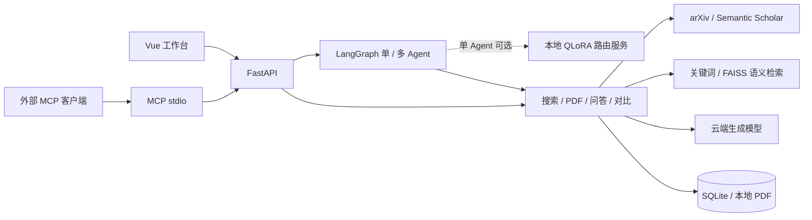

<div align="center">

# PaperScout

**从研究想法出发，找到论文，读懂内容，追溯证据。**

论文检索 · RAG 问答 · 单 / 多 Agent · MCP · QLoRA 工具路由


[应用 v1.0.0](https://github.com/mutesniper/PaperScout/releases/tag/paperscout-v1.0.0) · [默认适配器](https://github.com/mutesniper/PaperScout/releases/tag/router-v1.0.0) · [实验候选](https://github.com/mutesniper/PaperScout/releases/tag/router-v1.1.0-experimental.1) · [快速开始](#快速开始) · [系统架构](#系统架构) · [评测与进展](#评测与进展) · [项目结构](#项目结构) · [文档中心](docs/README.md)

</div>

## 项目简介

PaperScout 是面向本地单用户的论文研究工作台。输入自然语言研究想法，生成可编辑的检索计划；从 arXiv 和 Semantic Scholar 找到论文后，上传或获取 PDF，完成全文摘要、证据问答与多篇对比。

支持手动探索、LangGraph 单 Agent 工具循环和多角色协作。单 Agent 默认使用云端模型，也可切换为**本地微调小模型路由（实验）**，工具参数与研究内容仍由云端生成。

应用版本 `paperscout-v1.0.0` 固定本次交付源码，下载与验证范围见[版本说明](docs/releases/v1.0.0.md)。模型适配器使用独立的 `router-*` 版本。

## 核心能力

| 能力 | 实现 | 使用场景 |
| --- | --- | --- |
| 论文发现 | 检索计划、多来源搜索、去重、RRF 融合与本地排序 | 从想法查论文，按相关性、日期或引用量筛选 |
| 全文摘要 | 公开 PDF 获取或本地上传、解析、结构化总结 | 快速了解问题、方法和结论 |
| 证据问答 | 关键词 / Embedding 检索，答案附片段与 PDF 页码 | 核实单篇论文的方法与实验 |
| 多篇对比 | 选择 2～5 篇，按维度检索证据并生成对比 | 比较研究目标、方法、实验、结果与局限 |
| 研究任务助手 | 单 Agent；可选协调、检索、分析角色；预算、取消和历史 | 自动执行搜索 → 下载 → 分析 |
| 交付与集成 | 引用生成、Markdown 导出、MCP stdio 服务 | 整理阅读结果，供外部 AI 客户端调用 |

例如：`找两篇小模型调用工具的论文，阅读全文并比较它们的方法。`
也可以选择已有 PDF：`只使用这两篇论文，比较实验设置；信息不足时明确说明，并给出原文依据。`

## 系统架构



多 Agent 按需串行交接，继续使用云端决策。网页 Agent 直接调用内部工具；MCP 将业务能力开放给外部客户端。本地路由只选择下一步操作，后端校验后由云端生成固定工具的参数。[目录与架构](docs/architecture/README.md) · [本地路由启动](docs/guides/LOCAL_ROUTER.md)。

| 层次 | 技术栈 |
| --- | --- |
| 前端 | Vue 3、TypeScript、Vite、Playwright |
| API 与数据 | FastAPI、Pydantic、HTTPX、SQLite、pypdf |
| Agent 与检索 | LangGraph、工具调用、关键词检索、Embedding、FAISS、RRF |
| 集成与部署 | MCP、Docker Compose、Nginx |
| 离线训练实验 | PyTorch、Transformers、PEFT、bitsandbytes，SFT + QLoRA |

## 快速开始

### Docker

安装并启动 Docker Desktop，在项目根目录执行：

```powershell
if (-not (Test-Path .env)) { Copy-Item .env.example .env }
# 编辑 .env，配置生成模型后启动
docker compose up --build -d
```

打开 [http://localhost:8080](http://localhost:8080)。容器数据保存在独立持久化卷，与本地开发数据分开。[停止、更新与演示](docs/guides/DEMO.md)。

### 本地开发（Windows PowerShell）

需要 Python 3.11+、Node.js 20.19+ 或 22.12+，后端与前端分别使用一个终端。

```powershell
# 终端一：项目根目录
python -m venv .venv
.\.venv\Scripts\python -m pip install -r backend\requirements-lock.txt
if (-not (Test-Path .env)) { Copy-Item .env.example .env }
.\.venv\Scripts\python -m uvicorn app.main:app --app-dir backend --host 127.0.0.1 --port 8000
```

```powershell
# 终端二：项目根目录
cd frontend
npm ci
npm run dev
```

[工作台](http://127.0.0.1:5173) · [API 文档](http://127.0.0.1:8000/docs)。日常使用不需要安装训练依赖或下载小模型。

可选本地路由需要单独准备基座模型、适配器与 WSL 推理环境。按[本地路由指南](docs/guides/LOCAL_ROUTER.md)启动服务后，在研究任务助手中切换路由模式；工具参数和论文分析仍使用云端模型。

### 模型配置

根目录 `.env` 仅由后端读取，修改后重启后端。[完整配置](docs/guides/CONFIGURATION.md)。

| 环境变量 | 用途 | 要求 |
| --- | --- | --- |
| `LLM_BASE_URL` / `LLM_API_KEY` / `LLM_MODEL` | 检索计划、摘要、问答、对比、Agent | 使用生成模型功能时配置 |
| `EMBEDDING_BASE_URL` / `EMBEDDING_API_KEY` / `EMBEDDING_MODEL` | 语义检索 | 可选；全部留空使用关键词检索 |
| `SEMANTIC_SCHOLAR_API_KEY` | 来源认证 | 可选；公共接口可能限流 |
| `LOCAL_ROUTER_URL` | 本地微调路由服务 | 可选；默认 `http://127.0.0.1:8010` |

不配置生成模型仍可手动检索、上传 PDF 和查看已保存数据。Embedding 三项需全填或全留空，不自动复用生成模型配置。

## 评测与进展

### 工具路由 QLoRA · 2026-10-28

基于 **Qwen3-4B-Instruct-2507** 微调六类操作：搜索、下载、问答、对比、结束和澄清。最终版本使用 228 条训练样例，在 RTX 4060 Laptop 8GB 上完成 3 轮、171 次更新，峰值预留显存约 **5.37 GiB**。训练采用 NF4 / BF16、LoRA rank 8，仅监督路由 JSON。

| 评测指标 | 原始模型 | 上一版（第二组） | 最终版（第三组） |
| --- | --- | --- | --- |
| 原开发验证集路由命中 | 29/36（80.56%） | 30/36（83.33%） | **31/36（86.11%）** |
| 新冻结诊断集路由命中 | 22/36（61.11%） | 28/36（77.78%） | **29/36（80.56%）** |
| 模拟研究任务完成 | 14/20（70%） | 17/20（85%） | **19/20（95%）** |

相较原始模型，最终版在上述三项评测中分别提升 **5.56、19.44、25个百分点**。完整保留三组训练记录、逐题输出和失败分析，适配器保存与独立重载核验通过。

评测范围：原验证集用于选模；新诊断集在训练前冻结、不参与选模，但仍为作者自审的合成样例；模拟任务使用固定工具返回，不代表真实论文分析质量。120 条测试候选已在后续对照中首次评分，当前版为 105/120。最终模型已作为单 Agent 可选实验路由接入，仍有搜索与预算边界错误，由后端校验拦截；接入不改变上述离线指标。[完整实验报告](docs/evaluation/router/PROGRESSION_RUN.md) · [首轮训练记录](docs/evaluation/router/FORMAL_RUN.md)。

### 实验候选 · v1.1.0-experimental.1

[下载候选恢复包](https://github.com/mutesniper/PaperScout/releases/tag/router-v1.1.0-experimental.1) · [完整实验报告](docs/evaluation/router/CONSERVATIVE_RUN.md)

基于当前适配器，用 300 条样例低学习率续训两轮，选中第 2 轮。此版本单独以 **Pre-release** 发布，便于复现与比较；**本地路由仍使用 v1.0.0，应用默认采用云端模式**。

| 指标 | 当前本地 v1.0.0 | 实验候选 |
| --- | --- | --- |
| 开发验证 | 31/36 | **33/36** |
| 旧诊断集 | 29/36 | **30/36** |
| 首次评分测试候选 | 105/120 | 105/120 |
| 模拟研究任务完成 | **19/20** | 18/20 |

候选改善了明确目标的搜索判断，但新增了禁止联网时仍下载、未澄清选择就直接对比的错误，未通过不退化验收。发布附件包含适配器、配置、独立恢复脚本及评测报告，不含基座权重；请使用包内脚本实验，当前应用的身份校验不接受直接替换为候选权重。

分层评测还覆盖初始路由、取消与受阻处理、调用次数和失败轨迹，详见[三模型对照报告](docs/evaluation/router/PROGRESSION_RUN.md)。云端问答与单 / 多 Agent 的真实验证单独记录在[评测中心](docs/evaluation/README.md)。

本地 v1.0.0 路由已完成一个网页真实案例：搜索（命中缓存）→ 下载 TinyAgent PDF → 云端证据问答，4 次本地决策、6/6 处引用匹配对应 PDF 页。完整条件见[验收记录](docs/evaluation/AGENT_EVALUATION_RESULTS.md)；此单例不代表稳定成功率，本地模式继续作为实验选项。

## 项目结构

```text
PaperScout/
├── backend/
│   ├── app/
│   │   ├── main.py           # FastAPI 入口
│   │   ├── agent/            # 单 / 多 Agent、预算、本地路由
│   │   ├── tools/            # 工具契约、执行与资源校验
│   │   ├── llm/              # 云端模型适配
│   │   ├── search/           # 来源检索、去重与 RRF 排序
│   │   ├── papers/           # PDF 解析、导入与摘要
│   │   ├── rag/              # 检索、证据问答与多篇对比
│   │   ├── schemas.py        # 公共数据结构
│   │   └── storage.py        # SQLite 存储
│   ├── evaluation/           # 应用评测脚本与样本
│   ├── tests/                # 后端回归测试
│   └── mcp_server.py         # MCP stdio 服务
├── frontend/                 # Vue 工作台、浏览器测试、前端 Dockerfile
├── training/router/
│   ├── data/                 # 版本化样例与哈希清单
│   ├── formal_train.py       # QLoRA 训练
│   ├── progression_eval.py   # 原始 / 微调模型对照
│   ├── serve.py              # 本地路由推理服务
│   └── release/              # 适配器恢复脚本与说明
├── docs/
│   ├── guides/               # 启动、配置、使用与开发
│   ├── architecture/         # 模块职责与数据流
│   ├── evaluation/           # 应用与路由评测报告
│   └── plans/                # 路线图与变更记录
├── deploy/                   # Nginx 配置
├── outputs/                  # 本地权重与实验产物，不提交
├── .env.example              # 配置模板
├── compose.yaml              # Docker 服务与数据卷
├── Dockerfile                # 后端镜像
└── pytest.ini                # 默认测试配置
```

本地论文、数据库与缓存保存在 `backend/data/`，模型和实验产物保存在 `outputs/`，这两个目录不提交到 Git。训练数据、版本清单和依赖锁文件随源码保留。[后端模块导航](backend/README.md) · [文档导航](docs/README.md) · [训练实验入口](training/README.md)。

## 开发与验证

```powershell
# 项目根目录：离线测试，不调用云端
.\.venv\Scripts\python -m pytest backend/tests -q
.\.venv\Scripts\python -m pytest training/router -q
# 前端
cd frontend
npm run build
npx playwright test
```

真实服务评测需单独执行并可能产生费用；普通测试不等同真实模型验收。[开发说明](docs/guides/DEVELOPMENT.md) · [评测指南](docs/evaluation/EVALUATION.md)。

## 当前边界与路线图

- 面向本地单用户，尚无认证与多用户数据隔离，使用单后端进程。
- PDF 支持文字型文件，限制20 MB / 100页，暂不支持扫描件OCR；公开链接也可能下载失败。
- 引用可以追溯不代表结论必然正确，重要结论需核对原文。
- 本地微调路由为可选实验模式，需独立WSL推理服务；真实云端参数与论文分析全链路质量仍需验收。默认云端模式保持不变。

[项目计划](docs/plans/PLAN.md) · [训练计划](docs/plans/FINETUNING.md) · [开发记录](docs/plans/PROGRESS.md)
