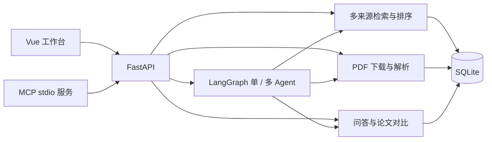

# 目录与架构

[返回项目首页](../README.md) · [文档导航](README.md)

## 请求如何流转

网页 Agent 直接调用内部工具；MCP 将已有 HTTP 接口封装给外部客户端。多 Agent 的角色按需串行协作，复用相同工具与预算，不是并行调用多个模型服务。

## 后端模块

| 文件 | 职责 |
| --- | --- |
| `backend/app/main.py` | 应用生命周期、依赖组装、检索接口 |
| `providers.py` / `ranking.py` | 来源请求、限流、元数据归一化、去重与 RRF / 本地排序 |
| `models.py` | 生成模型适配、结构化输出与调用日志 |
| `schemas.py` / `reading_schemas.py` | 请求、结果与 PDF 数据校验 |
| `reading.py` / `pdf_worker.py` | PDF 导入、下载校验、隔离解析及全文摘要 |
| `retrieval.py` / `qa.py` | 文本片段、关键词 / 向量检索与单篇证据问答 |
| `comparison.py` | 多篇论文按维度检索、生成与证据校验 |
| `agent.py` / `multi_agent.py` | 单 Agent 工具循环与多角色协调图 |
| `agent_budget.py` | 跨角色、跨工具共用调用预算 |
| `storage.py` | 检索、论文、摘要、问答、对比、任务和缓存持久化 |
| `backend/mcp_server.py` / `mcp_smoke.py` | 可选 MCP 接口与冒烟验证 |
| `backend/evaluation/` | 固定样本、真实论文清单和评测脚本 |

表中未带目录的 Python 文件均位于 `backend/app/`。具体接口以运行中的 `/docs` 为准。

## 前端组件

| 文件（位于 `frontend/src/`） | 职责 |
| --- | --- |
| `App.vue` | 页面布局、检索、历史及滚动导航 |
| `UsageGuide.vue` | 集中式操作指引 |
| `ResearchAgent.vue` | 单／多 Agent 启动、进度、取消和历史 |
| `ReadingPanel.vue` | PDF 上传、导入与全文摘要 |
| `PaperQuestions.vue` | 单篇问答与引用证据 |
| `PaperComparison.vue` | 多论文选择、对比和历史 |
| `CitationButton.vue` | 引用条目生成与复制 |
| `markdown.ts` | 摘要、问答和对比 Markdown 导出 |
| `style.css` | 公共视觉样式与响应式布局 |

## 数据与运行产物

| 位置 | 内容 |
| --- | --- |
| `backend/data/paperscout.db` | 本地 SQLite 数据与向量缓存 |
| `backend/data/pdfs/` | 已导入的 PDF 原文件 |
| Docker 命名卷 `paperscout-data` | 容器的数据，与上述本地目录独立 |
| `outputs/` | 本地评测结果等产物 |
| `frontend/dist/` | 前端构建输出 |
| `frontend/test-results/` | 浏览器测试结果与截图 |

运行数据、密钥、构建产物不应提交到仓库。向量持久化在 SQLite，FAISS 索引在查询时重建。不要通过移动数据目录或删除 Docker 卷来整理源码。

## 文档分工

首页只保留项目介绍和启动入口；`USAGE.md` 维护功能规则，`CONFIGURATION.md` 维护配置，`DEVELOPMENT.md` 维护验证命令。`PLAN.md` 记录计划，`PROGRESS.md` 记录变更，评测结果文档保留实验条件与局限。
