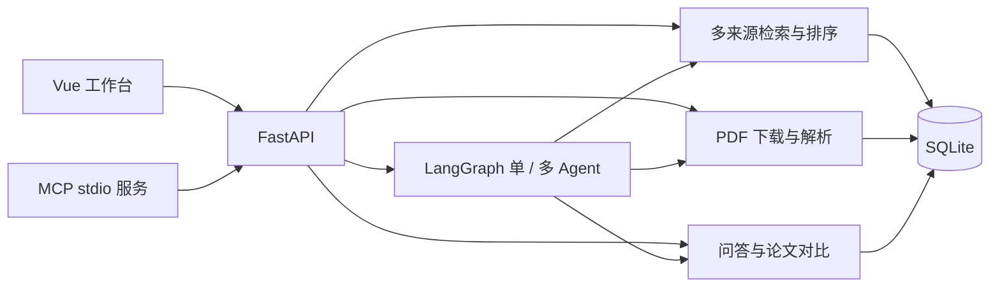

# 目录与架构

[返回项目首页](../../README.md) · [文档导航](../README.md)

## 请求如何流转



网页 Agent 直接调用内部工具；MCP 将已有 HTTP 接口封装给外部客户端。多 Agent 的角色按需串行协作，复用相同工具与预算，不是并行调用多个模型服务。

单Agent可选本地QLoRA路由：后端将真实目标、候选、PDF、结果、失败与剩余额度映射到训练契约，经HTTP请求独立WSL服务。校验route后云端在固定工具schema内生成参数，执行器检查ID和额度。澄清时保存状态并暂停，补充信息后恢复预算与上下文；失败不隐式回退。训练模块不被后端导入，后端只依赖轻量协议，测试核对提示词及状态结构一致性。

## 后端模块

| 文件 | 职责 |
| --- | --- |
| `backend/app/main.py` | 应用生命周期、依赖组装、检索接口 |
| `search/providers.py` / `search/ranking.py` | 来源请求、限流、元数据归一化、去重与 RRF / 本地排序 |
| `llm/client.py` | 生成模型适配、结构化输出与调用日志 |
| `schemas.py` / `papers/schemas.py` | 请求、结果与 PDF 数据校验 |
| `papers/service.py` / `papers/pdf_worker.py` | PDF 导入、下载校验、隔离解析及全文摘要 |
| `rag/retrieval.py` / `rag/qa.py` | 文本片段、关键词 / 向量检索与单篇证据问答 |
| `rag/comparison.py` | 多篇论文按维度检索、生成与证据校验 |
| `agent/core.py` / `agent/multi.py` | 单 Agent 工具循环与多角色协调图 |
| `agent/local_router.py` / `agent/router_contract.py` | 本地HTTP路由客户端、状态映射、版本与合法动作校验 |
| `tools/schemas.py` | 单/多 Agent 共用的工具参数、动作解析和动态 schema |
| `tools/search.py` | Agent 的 arXiv 优先搜索、简化查询和补充来源策略 |
| `tools/executor.py` | 工具执行入口、任务内论文 ID 校验、结果与失败记录 |
| `agent/budget.py` | 跨角色、跨工具共用调用预算 |
| `storage.py` | 检索、论文、摘要、问答、对比、任务和缓存持久化 |
| `backend/mcp_server.py` / `mcp_smoke.py` | 可选 MCP 接口与冒烟验证 |
| `backend/evaluation/` | 固定样本、真实论文清单和评测脚本 |
| `training/router/serve.py` | 独立WSL GPU推理服务，默认本机8010端口 |

除显式带 `backend/` 前缀的条目外，表中路径均相对于 `backend/app/`。具体接口以运行中的 `/docs` 为准。重构只调整模块位置和导入，FastAPI入口保留；PDF子进程改用 `app.papers.pdf_worker`，其工作目录仍为backend。

## 前端组件

| 文件（位于 `frontend/src/`） | 职责 |
| --- | --- |
| `App.vue` | 页面布局、检索、历史及滚动导航 |
| `UsageGuide.vue` | 集中式操作指引 |
| `ResearchAgent.vue` | 单／多 Agent 启动、进度、取消和历史 |
| `ReadingPanel.vue` | PDF 上传、导入与全文摘要 |
| `PaperQuestions.vue` | 单篇问答与引用证据 |
| `PaperComparison.vue` | 多论文选择、对比和历史 |
| `CitationButton.vue` | 引用条目生成与复制 |
| `markdown.ts` | 摘要、问答和对比 Markdown 导出 |
| `style.css` | 公共视觉样式与响应式布局 |

## 数据与运行产物

| 位置 | 内容 |
| --- | --- |
| `backend/data/paperscout.db` | 本地 SQLite 数据与向量缓存 |
| `backend/data/pdfs/` | 已导入的 PDF 原文件 |
| Docker 命名卷 `paperscout-data` | 容器的数据，与上述本地目录独立 |
| `outputs/` | 本地评测结果等产物 |
| `frontend/dist/` | 前端构建输出 |
| `frontend/test-results/` | 浏览器测试结果与截图 |

运行数据、密钥、构建产物不应提交到仓库。向量持久化在 SQLite，FAISS 索引在查询时重建。不要通过移动数据目录或删除 Docker 卷来整理源码。

## 文档分工

首页展示能力、架构、启动入口与有明确口径的实测摘要。详细说明按以下目录维护：

| 位置 | 内容 |
| --- | --- |
| `docs/guides/` | 使用、配置、启动、开发和MCP说明 |
| `docs/architecture/` | 业务模块、数据流与目录职责 |
| `docs/evaluation/` | 应用评测方法及真实调用报告 |
| `docs/evaluation/router/` | 原始基线、数据审核、QLoRA与分层任务报告 |
| `docs/plans/` | 项目路线图、训练计划、开发记录 |
| `training/router/` | 实验代码、测试、依赖与版本化数据，保留原命令入口 |

实验报告从训练源码目录集中到文档目录；实际权重与原始输出仍在 `outputs/`，不搬动数据库、模型缓存或虚拟环境。业务目录保留 `backend/` 与 `frontend/`，避免为统一外观改变启动、导入和Docker路径。


## Agent 工具层

```text
backend/app/tools/
├── __init__.py    # 公共执行器与 schema 入口
├── schemas.py     # search / download_pdf / answer / compare / finish
├── search.py      # 有界来源搜索策略
└── executor.py    # 单/多 Agent 共用执行器
```

`agent/core.py` 负责运行生命周期、预算、重复操作限制与调度；`agent/multi.py` 负责角色交接。`ToolExecutor` 每个任务独立创建，持有本任务的候选和下载结果，执行前校验论文 ID 范围，再复用 `papers/service.py`、`rag/qa.py`、`rag/comparison.py` 的业务服务。没有复制下载、RAG 或证据校验实现。

工具动作字段、历史记录格式和 HTTP API 不变；旧 `read` 动作仍由解析器兼容为 `download_pdf`。MCP 继续通过 HTTP 封装业务能力，不依赖内部 Agent 状态。工具调用次数与重复请求检查保留在调度层，避免单/多角色分别产生额度。
